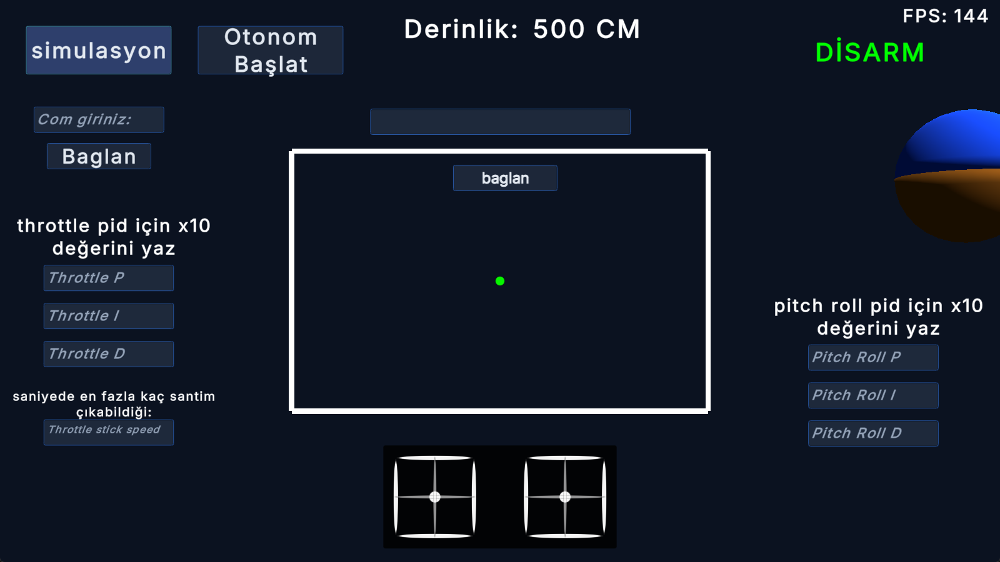
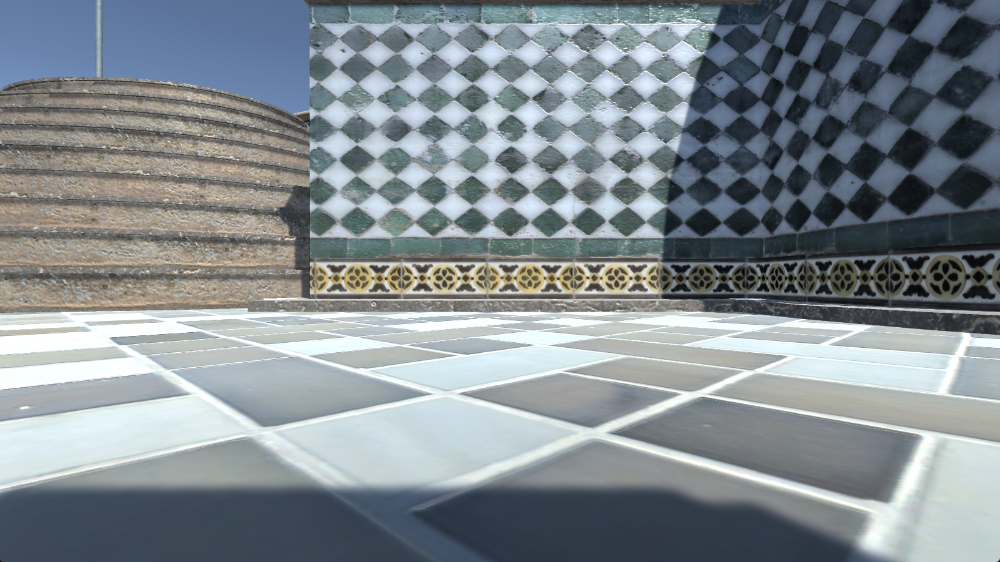
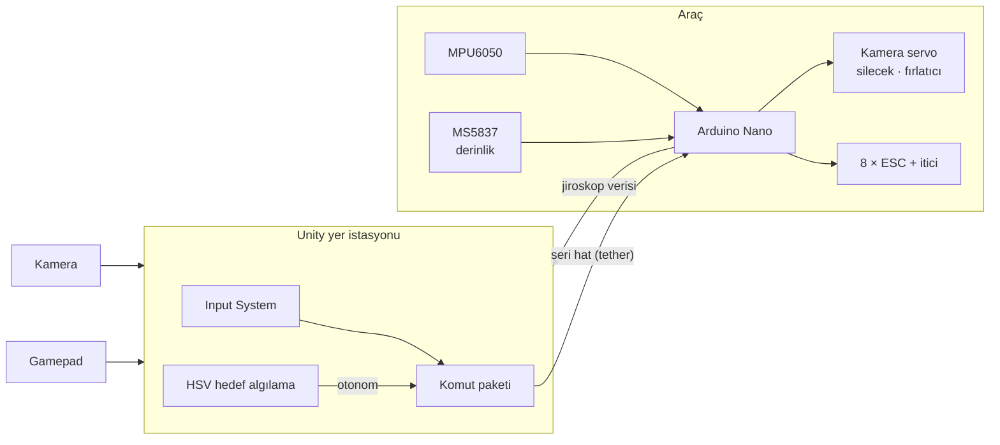

# 🌊 İnsansız Su Altı Aracı (ROV): Kontrol İstasyonu ve Uçuş Yazılımı

**8 iticili su altı aracı için PID dengelemeli ve derinlik sabitlemeli Arduino firmware'i, gamepad ile kontrol edilen Unity yer istasyonu, kamera ile otonom hedef takibi ve 3B simülasyon**

## Proje hakkında
Su altı görevleri için geliştirilen bir ROV'un hem araç üstü yazılımını hem de yüzeydeki kontrol istasyonunu yazdım.

Pilot, gamepad ile aracı Unity arayüzü üzerinden sürer. Komutlar seri hat üzerinden araçtaki Arduino'ya gider. Arduino, IMU ve basınç sensörü verisiyle aracı kendi kendine dengede tutar ve istenen derinlikte sabitler. Kamera görüntüsü arayüzde gösterilir. **Otonom modda** görüntüdeki kırmızı hedef algılanır ve araç hedefe yönlendirilir.

## Özellikler
- **8 iticili vektörel düzen:** 4 yatay ve 4 dikey itici (ESC + PWM 1000–2000 µs), ayrıca kamera tilt servosu, kamera sileceği ve 2 fırlatıcı mekanizması.
- **Dengeleme:** MPU6050 (DMP) ile pitch/roll ölçülür. Her eksen için ayrı **PID** döngüsü aracı yatay tutar.
- **Derinlik sabitleme:** MS5837 basınç sensörü ile derinlik ölçülür. Throttle bırakıldığında PID, hedef derinliği korur.
- **Yer istasyonu (Unity)**
  - Gamepad (Unity Input System) ile 4 eksen ve buton kontrolü.
  - ARM/DISARM durumu, ufuk göstergesi (yapay ufuk küresi) ve joystick göstergeleri.
  - **Çalışma sırasında PID katsayılarını değiştirme (canlı ayar):** P/I/D değerleri araç durdurulmadan güncellenir.
  - Seri hat üzerinden araçtan gelen jiroskop verisinin okunması.
- **Otonom hedef takibi:**
  - Webcam görüntüsü HSV uzayında taranır ve kırmızı hedefin ağırlık merkezi bulunur.
  - Hedef ekranın sağında, solunda, üstünde ya da altında olmasına göre yaw/throttle komutları üretilir.
- **Simülasyon modu:** Donanım olmadan sürüş pratiği için fizik tabanlı (Rigidbody) bir havuz sahnesi.

## Mimari

## Nasıl denenir
1. [Releases](../../releases) sayfasından `ROVControlStation-Windows.zip` dosyasını indirip `ROVControlStation.exe` ile başlat.
2. **simulasyon** düğmesiyle donanım gerektirmeyen simülasyon sahnesine geç. Bir Xbox/PlayStation kumandası takılıysa aracı sürebilirsin.
3. Gerçek araçla çalışırken COM numarasını girip **Bağlan**'a bas, ardından ARM et.

## Kod örnekleri
- [`firmware/su_alti_nano_asil/motor_pid_hesapla.ino`](showcase/firmware/su_alti_nano_asil/motor_pid_hesapla.ino): pitch/roll/derinlik PID ve itici karışımı (mixer).
- [`firmware/su_alti_nano_asil/gyro.ino`](showcase/firmware/su_alti_nano_asil/gyro.ino): MPU6050 DMP okuma.
- [`unity/su_alti_camera.cs`](showcase/unity/su_alti_camera.cs): webcam ile HSV renk takibi ve otonom komut üretimi.
- [`unity/arduino_Control.cs`](showcase/unity/arduino_Control.cs): seri haberleşme ve telemetri ayrıştırma.

## Neler öğrendim
- Çok iticili bir araçta PID ayarı ve iticilerin karıştırılması (motor mixing).
- Basınç sensörüyle derinlik ölçümü ve kapalı döngü derinlik kontrolü.
- Gerçek zamanlı görüntüden basit ama sağlam bir hedef takip mantığı kurmak.

---
© Ahmet Emin Arslanbaş — Tüm hakları saklıdır. Kod inceleme amaçlı paylaşılmıştır.
